<p align="center">
  
</p>

<p align="center">
  <b>Wonderpark: an unofficial PokéPark 2 recomp.</b><br>
  <b>Play PokéPark 2: Wonders Beyond natively on Windows, at 60 FPS (or more) and high resolutions, with keyboard, mouse or a controller.</b><br>
  A static recompilation of the Wii game, built on your own PC from your own disc.
</p>

<p align="center">
  <a href="#getting-started">Getting started</a> ·
  <a href="#controls">Controls</a> ·
  <a href="#mods">Mods</a> ·
  <a href="#faq">FAQ</a> ·
  <a href="#building-from-source">Build from source</a>
</p>

> [!IMPORTANT]
> **Wonderpark is an unofficial, non-commercial fan project. Not affiliated with or endorsed by Nintendo, The Pokémon Company, Creatures Inc. or Game Freak. Contains no game files; you need your own disc.** To play, you need your own copy of **PokéPark 2: Wonders Beyond (US, game ID S2LE01)**, dumped from a disc you own. Please don't ask for or share game files, ISOs or built copies of the game. (Wonderpark is also unrelated to the 2019 film *Wonder Park*.)

---

## What is Wonderpark?

Wonderpark is a **static recompilation** of PokéPark 2: Wonders Beyond. Instead of emulating the Wii, the game's own code is translated into native PC code and compiled into a real Windows program. That's why it can run at 60 FPS and above, at high resolutions, and with proper keyboard, mouse and controller support.

Nothing from the game is in this repository. The Wonderpark launcher reads **your** disc image, then recompiles and builds the game **on your PC**, one time. After that you just press Play.

Wonderpark is a work in progress (a development preview): it has been played from the start of the story through the first areas and all four attractions, but a full playthrough hasn't been done yet.

## Features

| | |
| --- | --- |
| **60 FPS and above** | The game runs at 60 FPS at its original speed; 120, 144 or 240 FPS blend the frames between (smoother turning). Pre-rendered movies stay at their original speed. |
| **High resolution** | Render at 2× to 6× the Wii's resolution, with anti-aliasing and texture filtering. Tested at 2560×1440. |
| **Widescreen** | The game's own 16:9 mode, and wider screens (21:9 up to 32:9) see more to the sides. The HUD can stay in the middle or move out to the screen's edges. |
| **No motion controls needed** | Shakes, swings, tilts and pointing are mapped to buttons, the mouse or the sticks. Every action can be rebound: two keyboard and two controller slots per action. |
| **Controllers** | Controllers through SDL3 (Xbox, PlayStation and Switch pads; so far tested with an Xbox-style pad), with matching button icons in the game's prompts. |
| **In-game settings** | Press **F1** any time for every setting (the game pauses), or use the **PC Settings** row in the game's own Options menu. |
| **Friend Book** | In F1: who you've befriended, area by area, with each Pokémon's own hint from the game's Pad. |
| **Mod manager** | Install texture and file mods from a .zip in the launcher, and turn each on or off with a switch. |
| **Japanese voices** | Switch the Pokémon's voices to Japanese with your own Japanese disc. |
| **Smooth play** | A shader setup that never stutters, fast loading (the game's files read into RAM), save backups. |

### Project status

| Area | Status |
| --- | --- |
| Disc check, extraction, recompiling, building | Working (the launcher does it all) |
| Boot, title screen, menus, saving | Working |
| The park: areas played so far, battles, chases | Working, 60 FPS |
| Attractions without motion controls | Cake Contraption, Power Bash and Flight of Fancy working; Dance Inferno partly (the shake keys dance whatever move is due) |
| Frame rates above 60 (120 / 144 / 240) | Working |
| Widescreen and ultrawide | Working |
| F1 settings, the Options page's PC Settings, the Friend Book | Working |
| Japanese voices (needs your own Japanese disc) | Working, from the next start |
| Mod manager | Working |
| Local multiplayer (2-4 players) | In progress: extra controllers join as Wii Remotes 2-4 in Multiplayer Attractions; a full multiplayer round hasn't been tested yet |
| Skipping movies | In progress (not working yet) |
| A full playthrough | Not done yet |
| Vulkan renderer, HDR, aim assist, online play | Planned |
| Release downloads | Not yet: build it from source for now |
| Linux / macOS / Steam Deck | Not planned yet |

Found a bug? [Open an issue](../../issues/new/choose). The template asks for what we need.

## Getting started

There's no download yet. For now you build the launcher from this repository once, and the launcher does the rest.

### What you need

- **Windows 10 or 11, 64-bit**
- **A graphics card with OpenGL 3.3** (any card from the last ten years)
- **About 2 GB of free space** besides your disc image (the extracted disc, the recompiled code and the program). An SSD loads faster; a hard drive works.
- **Your own PokéPark 2: Wonders Beyond disc image, US version (S2LE01)**: `.iso`, `.wbfs`, `.rvz` or NKit. Other regions aren't supported yet.
- **[Python 3](https://www.python.org/)** (3.10 or newer).
- **[Visual Studio Build Tools](https://visualstudio.microsoft.com/downloads/)** with the "Desktop development with C++" workload (CMake and Ninja come with it), plus the "C++ Clang tools for Windows" component. Clang makes the game run about twice as fast as Microsoft's compiler; an [llvm-mingw](https://github.com/mstorsjo/llvm-mingw) install also works.
- **[decomp-toolkit](https://github.com/encounter/decomp-toolkit)** (`dtk.exe`) on your PATH or in `tools\bin`, for reading a plain `.iso`, `.wbfs` or `.rvz` (NKit images are read without it).

**How to get the disc image:** dump your own disc with a modded Wii and CleanRip, following [Dolphin's guide to ripping games](https://dolphin-emu.org/docs/guides/ripping-games/). Wonderpark checks the game ID and warns you if the image doesn't match a clean US copy.

### Install

1. Get the source: `git clone --recursive <this repository's URL>` (the `--recursive` fetches DolRecomp and SDL3).
2. In that folder, build the launcher once: `python tools/build_launcher.py`
3. Run `build\launcher\WonderparkLauncher.exe`.
4. **Click the logo**, then the one button: **Place ISO** (pick your disc image; Wonderpark verifies it).
5. **Build**: checks and extracts the disc, recompiles the game and compiles it (20-30 minutes the first time; the star lights up as each stage finishes).
6. **Play**. Next time the launcher goes straight to Play, or offers Rebuild after an update.

Optional, for about a third less CPU time per frame: once you have a save in a busy area, `python tools/pgo_train.py`, then build again.

**Don't share your built game folder** (`game\`, `generated\`, `build\`): it contains the game's code and files from your disc.

## Controls

The game was played with a sideways Wii Remote. Wonderpark maps every move to keyboard, mouse or controller, and you can change any of them in **F1 → Controls**. The defaults:

| Wii Remote | Keyboard / mouse | Controller |
| --- | --- | --- |
| Move (d-pad) | WASD or arrow keys | Left stick or d-pad |
| Jump (2) | Space or X | A |
| Attack / charge (1) | Left click or Z | X |
| Talk / confirm (A) | Right click or Enter | B |
| Back (B) | V or Left Ctrl | Y or right trigger |
| Special move (shake) | Q or Left Shift | LB |
| Shake, second key | E | RB |
| Menu (+) | P | Start |
| − button | M | Back / View |
| Home | Home or H | Right stick click |
| Pointer (attractions, menus) | Mouse | Right stick (Auto, or set it in F1) |
| Camera | Mouse (free camera) | Right stick |
| Settings | F1 | Back + Start |

**Attractions:** Cake Contraption aims with the mouse or right stick. Power Bash swings with the special-move keys. Flight of Fancy steers with the stick or the movement keys. Dance Inferno dances with the special-move keys (whatever move is due).

## Settings

- **In the game's Options menu:** a **PC Settings** row for display mode, resolution, frame rate, anti-aliasing, graphics quality, widescreen, V-Sync and button icons.
- **Anywhere in game, press F1:** the full settings notebook (Display, Graphics, Controls, Audio, Gameplay, Multiplayer, Silly) and the Friend Book. The game pauses while it's open and changes apply right away. Unfinished settings are shown with a "Coming soon" stamp.

Settings are saved in `%APPDATA%\Wonderpark\settings.ini` and controls in `%APPDATA%\Wonderpark\bindings.ini`. Every setting can also be overridden with an environment variable `WONDERPARK_<NAME>` (see [docs/DEVELOPMENT.md](docs/DEVELOPMENT.md)).

## Mods

Open the launcher, click **MODS** on the right edge, then **Install from .zip**. Each mod gets an on/off switch, and changes apply the next time you press Play.

A Wonderpark mod is a `.zip` with a `mod.json` at its root:

```json
{
  "id": "hd-wish-park",
  "name": "HD Wish Park Textures",
  "summary": "Sharper textures for Wish Park and the attraction stages.",
  "version": "1.0",
  "author": "Your name",
  "game": "S2LE01"
}
```

Supported content: `textures/` (replacement textures, matched by Wonderpark's own texture hash names) and `files/` (replacement game files at the same paths). Mods are installed to `%APPDATA%\Wonderpark\mods`. Only install mods you trust, and don't put game files you don't have the rights to share into a mod.

## FAQ

**Where are my saves?**
In `%APPDATA%\Wonderpark\nand\title\00010000\53324c45\data\`, laid out like a Wii's (and Dolphin's) NAND. With Save backups on (the default), a copy of each slot is kept in `%APPDATA%\Wonderpark\backups\` before every save.

**Can I share my built copy with a friend?**
No. Your built Wonderpark folder contains game code recompiled from your disc, so sharing it means sharing the game. Your friend can build their own from their own disc.

**Does it work with the European or Japanese version?**
Not yet. Only the US disc (S2LE01) is supported. A Japanese disc can be used for the Japanese voices only.

**Can I switch the Pokémon voices to Japanese?**
Yes, with your own Japanese disc (S2LJ01): drop its image on the launcher, then choose Japanese in F1 → Audio. The voices change from the next start.

**Is this an emulator?**
No. The game's code is recompiled ahead of time into native code. Wonderpark only recreates the parts of the Wii the game talks to (graphics, sound, controls, files).

**The game stutters on my PC.**
Keep F1 → Graphics → Shader compilation on Smooth, turn on Fast loading, and try a lower internal resolution. If it still stutters, open an issue.

## Building from source

The launcher (above) runs these for you. To run them by hand (Windows, with the tools from [What you need](#what-you-need)):

```powershell
git clone --recursive <this repository's URL>
cd Wonderpark
# all at once: verify and extract the disc, recompile, build
python builder/pipeline.py path\to\your\disc.iso
# or step by step:
python tools/extract_disc.py path\to\your\disc.iso   # into game/
python tools/recomp.py                                # DolRecomp, into generated/
python tools/build_game.py                            # into build/game/ (clang-cl, Ninja, ThinLTO)
.\build\game\Wonderpark.exe
```

`python tools/build_game.py --no-lto` builds faster for development. See [docs/DEVELOPMENT.md](docs/DEVELOPMENT.md) for the project layout, where each kind of fix belongs, and every setting and environment variable, and [docs/recomp-status.md](docs/recomp-status.md) for the progress notes.

### Repository layout

| Folder | Holds | In git |
| --- | --- | --- |
| `builder/` | Launcher and one-time builder | yes |
| `tools/` | Disc check, extraction, recompile and build scripts | yes |
| `config/` | Recompiler config, function names, patches | yes |
| `runtime/` | Graphics, audio, input, file I/O, settings | yes |
| `docs/` | Design notes, mockups | yes |
| `assets/` | The app icons (our own art) and the controller icons | yes |
| `game/` | Your extracted disc | no |
| `generated/` | Recompiled code | no |
| `build/` | Compiled program | no |

## Credits

- **[MildRain479/PokePark-Wiicompiled](https://github.com/MildRain479/PokePark-Wiicompiled)** (a recomp of PokéPark Wii: Pikachu's Adventure, CC0 1.0). Wonderpark's runtime is based on its `recomp/` runtime code. None of that project's decompiled game sources are used here.
- **[MildRain479/PokePark-2-Wiicompiled](https://github.com/MildRain479/PokePark-2-Wiicompiled)** (a recomp of PokéPark 2: Wonders Beyond, CC0 1.0). Adapted from its code: the free camera and field of view (`hle_camera.c`), scene tracking and the attraction test hook (`hle_scene.c`, from its `hle_game.c`), the battle damage and chase speed options (`hle_modifiers.c`), the friends data (`hle_friends.c`, from its `hle_friends.c` and `hle_pad_art.c`), in-game button prompts (`hle_prompts.c`, from its `hle_prompts.c` and `boot/prompts.c`), Flight of Fancy's steering (`hle_wpad.c`, from its `hle_motion.c`), the Dance Inferno timing hooks (`hle_dance.c`) and the event-script check (`hle_scene.c`, from its `hle_autosave.c`). [THIRD_PARTY_NOTICES.md](THIRD_PARTY_NOTICES.md) lists every file.
- **[DolRecomp](https://github.com/ExpansionPak/DolRecomp)** by ExpansionPak (GPL-3.0-or-later): the PowerPC-to-C recompiler, used as a git submodule. A `Wonderpark.exe` you build contains GPL-3.0 code from DolRecomp (its CPU helpers and the code it generates).
- **[SDL3](https://github.com/libsdl-org/SDL)** (zlib license): controllers in the game and the launcher; a git submodule pinned to release 3.4.20.
- **[decomp-toolkit](https://github.com/encounter/decomp-toolkit)** (MIT / Apache-2.0): disc extraction (run as a separate program, not included).
- **[chasem-dev/sms-pc-port](https://github.com/chasem-dev/sms-pc-port)**: inspiration for features and project organization.
- **[Dolphin](https://dolphin-emu.org/)**: years of documentation about how the Wii works.
- Fonts: [Fredoka](https://fonts.google.com/specimen/Fredoka) and [Nunito](https://fonts.google.com/specimen/Nunito), SIL Open Font License 1.1.
- Controller icons: [Flat Gamepad Icons](https://robthefivenine.itch.io/flat-gamepad-icons) by RobTheFiveNine, CC BY-SA 4.0, in `assets/ui/pad-icons/` with their license. The pack's platform-logo icons are left out; the home icon is adapted in the same style under the same license. The CC BY-SA license covers those icons only.
- Our own art, all drawn in code with no game assets: the Wonderpark icon and compass-star emblem, the banner, the launcher, and the F1 notebook (its cover, gold corner pieces, paw prints and stickers).
- Built with help from Claude Code.

## Legal

*Pokémon* and *PokéPark* are trademarks of Nintendo, The Pokémon Company, Creatures Inc. and Game Freak. **Wonderpark is an unofficial, non-commercial fan project. Not affiliated with or endorsed by Nintendo, The Pokémon Company, Creatures Inc. or Game Freak. Contains no game files; you need your own disc.** Game and character names are used only to say what Wonderpark works with.

- This repository contains **no game code, assets or data**: no disc images, no extracted files, no recompiled game code, no game textures, sounds, text or icons. Everything game-derived is made on your PC from your own disc and stays there.
- Wonderpark does not help anyone get the game. Don't ask for or share disc images, ISOs, ROMs or built copies of the game, in issues or anywhere else. Requests like that are closed.
- Wonderpark is free and will never be sold, take donations or show ads.
- If you represent a rights holder and have a concern, please open an issue, and it will be dealt with promptly.

## License

Wonderpark's own code is released under CC0 1.0 Universal (see [LICENSE](LICENSE)). Third-party components keep their own licenses ([THIRD_PARTY_NOTICES.md](THIRD_PARTY_NOTICES.md)). A `Wonderpark.exe` you build links DolRecomp's GPL-3.0 code, so that built program as a whole is covered by GPL-3.0.
